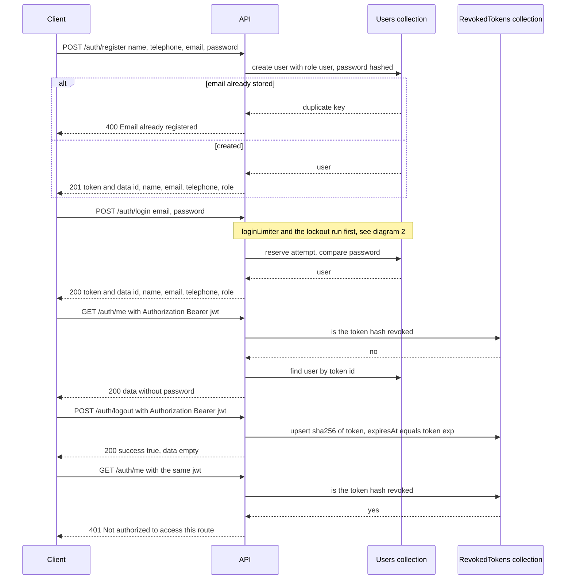
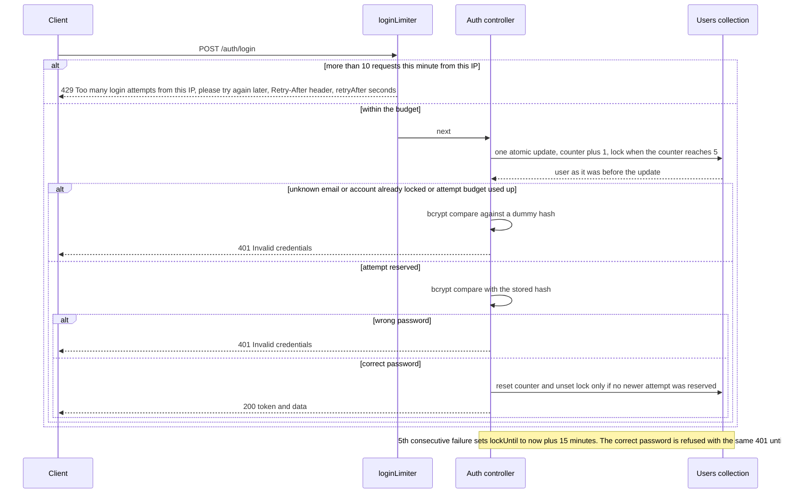
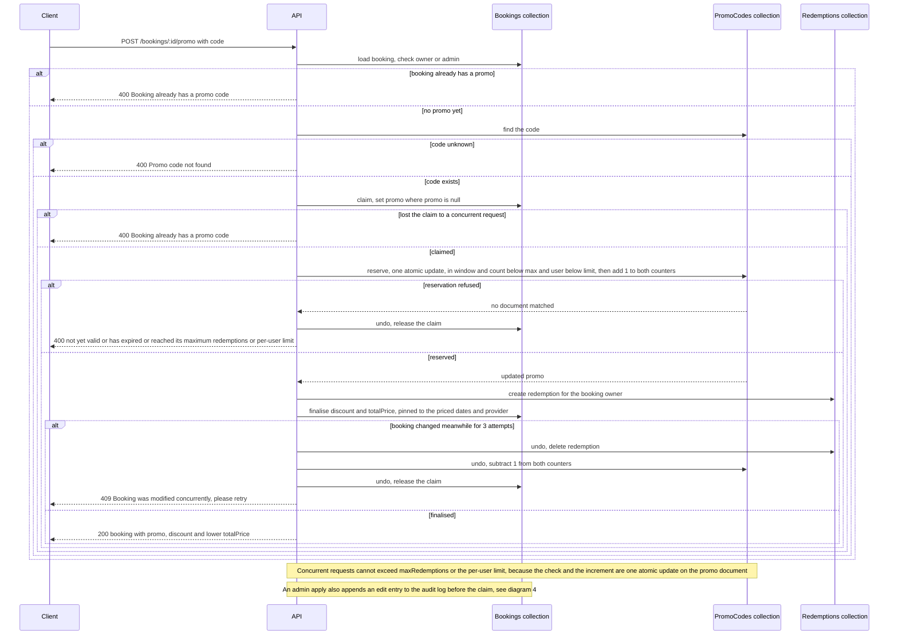
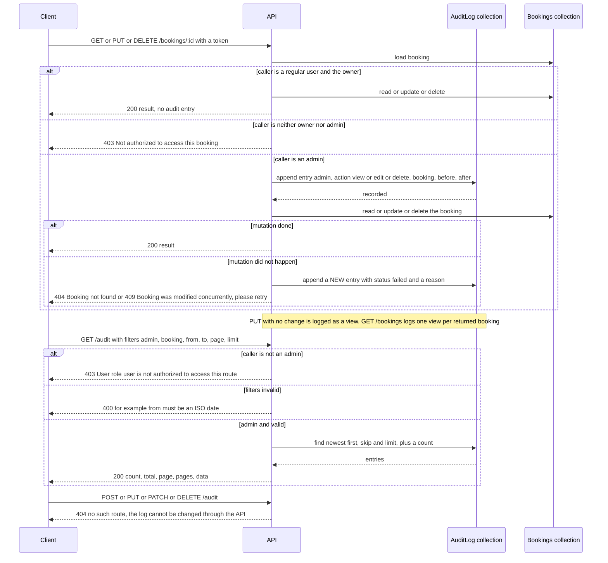
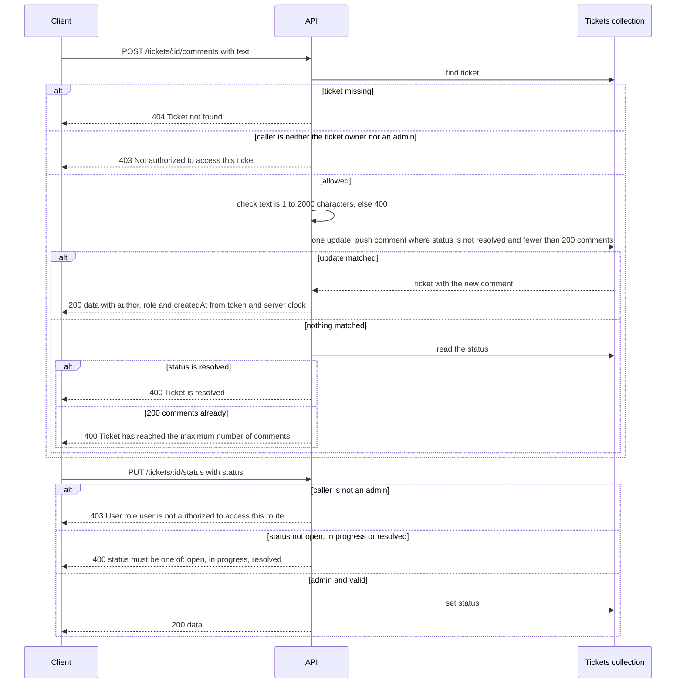
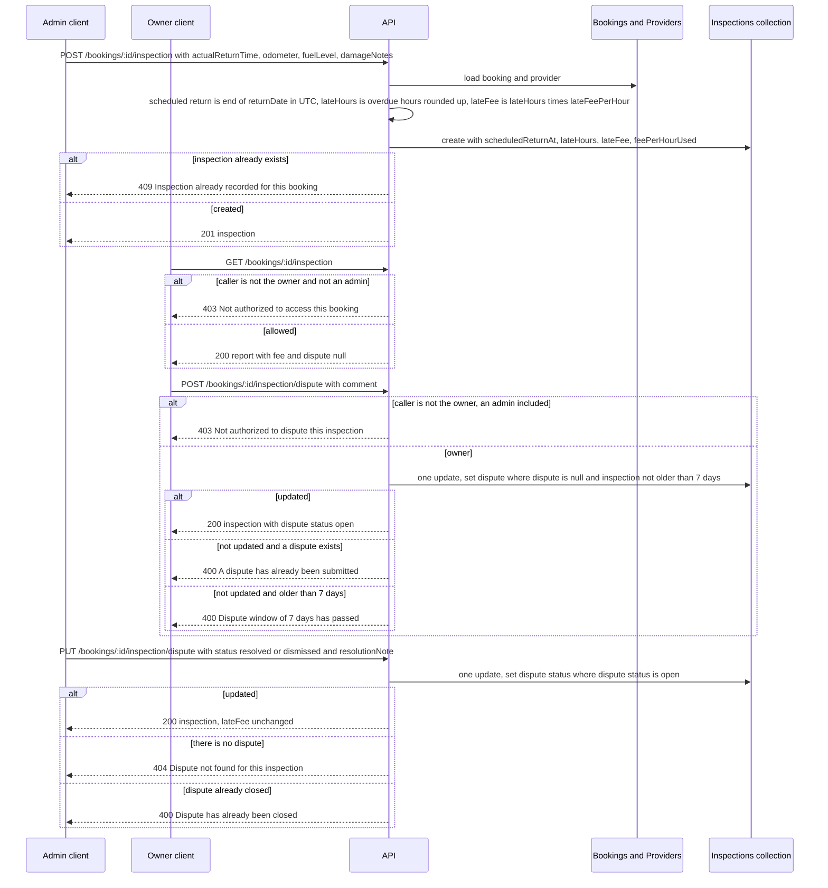
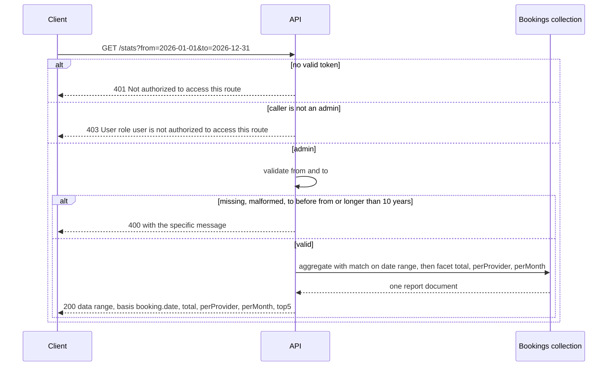

# Sequence Diagrams

Rental Car Booking REST API (Project #7), course 2110336 SW Dev Practice.

## Scope

This document describes the WHOLE API, because the modified class code (Assignment 7) and the added capabilities form one API. There is one diagram per added capability. Every status code and message below is taken from `controllers/` and `middleware/`.

> **Modified from the class code (Assignment 7, VacQ).** The starting point is the Assignment 7 source exactly as received, commit `c617bb6` ("base: Assignment 7 source as received"). See what differs with `git diff c617bb6 main --stat`. In short: Hospital and Appointment became Provider and Booking; the A7 auth code was modified (the role is no longer chosen by the client, one `401` for every login failure, logout with token revocation, account lockout and a per-IP limit, no hard-coded seed password); and promo codes, the audit log, support tickets, return inspections and statistics were added.

Related documents: [requirements](requirements.md), [use cases](use-cases.md), [UML profile for API](uml-profile-for-api.md), [work division](work-division.md).

Reading notes: the API answers every error with `success false` and a `message`. A `401 Not authorized to access this route` is the answer of the `protect` middleware (no header, bad token, revoked token, or deleted user). A non-admin on an admin route gets `403 User role user is not authorized to access this route`.

## 1. Register, login and logout with token revocation

Register stores a new user (the role is always `user`) and returns a signed JWT. Login returns a token with a unique id inside, so two logins give two different tokens. Logout stores the SHA-256 hash of the token in the `RevokedToken` collection with a TTL equal to the token's own expiry. The `protect` middleware checks that collection on every request, so a replay of a logged-out token gets the same 401 as a forged token.

## 2. Login protection: lockout and the IP rate limit

Two independent defences. First the `loginLimiter` middleware counts every login request per client IP (10 per minute, whatever the outcome) and answers 429 with a `Retry-After` header before the controller runs. Second, inside the controller, one atomic update reserves the attempt on the user document BEFORE the password is compared: it adds one to the counter and, when the counter reaches the limit (5 by default, `LOGIN_MAX_ATTEMPTS`), sets `lockUntil` to now plus 15 minutes (`LOGIN_LOCK_MINUTES`) in the same update. Concurrent logins are serialised by the database, so parallel guesses cannot get more than 5 real password checks per lock window. Wrong password, unknown email and a locked account all give the identical `401 Invalid credentials` and each costs one write and one bcrypt compare, so neither the body nor the timing shows which case happened. A correct password resets the counter.

## 3. Apply a promo code with atomic reservation and undo

The steps are ordered so that no request can take more than its share. (a) The booking is claimed first (`promo` set only where it is still null), so a second apply on the same booking stops here. (b) The promo is reserved by ONE conditional `findOneAndUpdate`: the validity window, `redemptionCount < maxRedemptions` and the per-user usage are all in the filter and both counters are incremented in the same update. (c) A redemption record is written. (d) The booking price is finalised, pinned to the dates and provider the price was computed from, and retried up to 3 times if the booking was edited meanwhile, otherwise 409. If anything after the claim fails, the undo runs in reverse order (delete redemption, release the reservation, release the claim) and each undo step runs only once. A failed reservation releases only the claim and leaves the redemption count and the booking price as they were.

The reservation-refused messages are exactly: `Promo code is not yet valid`, `Promo code has expired`, `Promo code has reached its maximum redemptions` and `You have reached the per-user limit for this promo code`, chosen by reading the promo again after the refusal. Other 400s on this route are `Please provide a promo code` and `Booking has no price to discount`.

## 4. Admin audit write, and reading the audit log

Every ADMIN view, edit and delete of a booking appends one entry to the audit log BEFORE the booking is read out or changed, so a mutation can never succeed without its record. For an edit the entry holds only the changed fields, before and after. If the mutation then does not happen, a NEW entry with status `failed` and a reason is appended; the earlier entry is never edited. A regular user's own actions write nothing. The log has no write route: `GET /audit` is the only audit route, and the Mongoose model refuses every update and delete path.

## 5. Ticket comment and ticket status

A comment is one atomic `$push` whose filter says the ticket is not `resolved` and still has room for another comment (at most 200). Because the rule and the write are one operation, a status change racing a comment cannot slip a comment onto a resolved ticket. When the update matches nothing, one read explains why. The comment's author and role come from the token and the time from the server clock. An admin sets the status in a separate request and can reply with the same comment route.

## 6. Inspection with late fee, then dispute

The admin records the return. The server computes the fee: the scheduled return instant is the END of the booking's `returnDate` in UTC (23:59:59.999Z), the overdue time is rounded up to whole hours, and the fee is those hours times the provider's `lateFeePerHour` as it is at that moment, which is stored with the inspection. A unique index allows one inspection per booking. The owner (and only the owner) can then dispute once, and only within 7 days of the inspection record, inclusive; both rules are inside one atomic compare-and-set. If both rules are broken the answer is `already been submitted`. An admin closes the dispute with `resolved` or `dismissed`, also by one compare-and-set on `dispute.status` being `open`. Resolving records a decision and does not change the fee.

## 7. Statistics report

The report is one database aggregation. `$match` selects the bookings whose pickup date is inside the inclusive UTC range, using the `date, provider` index, and `$facet` computes the total, the per-provider counts and the per-month counts in a single pass. The top 5 is the first five of the per-provider list, which is ordered by count descending, then name, then id. Months without bookings are omitted. Nothing is counted in application code.

