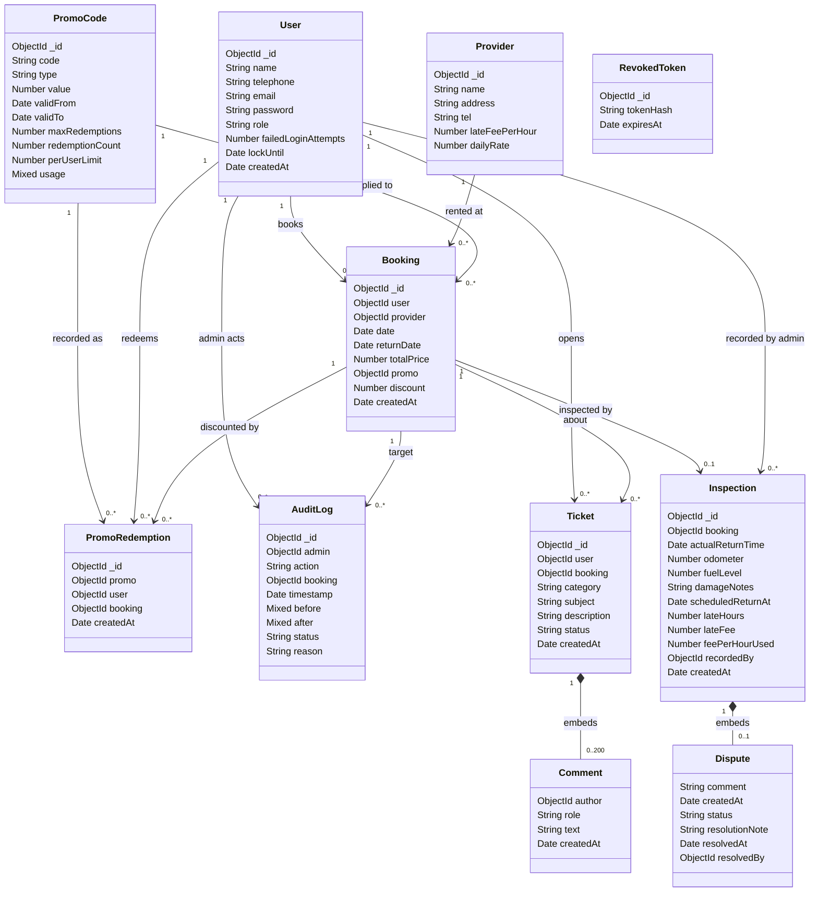

# UML Profile for API

Rental Car Booking REST API (Project #7), course 2110336 SW Dev Practice.

## Scope

This document describes the WHOLE API, because the modified class code (Assignment 7) and the added capabilities form one API. Every route listed here exists in `routes/*.js` and is mounted in `server.js`.

> **Modified from the class code (Assignment 7, VacQ).** The starting point is the Assignment 7 source exactly as received, commit `c617bb6` ("base: Assignment 7 source as received"). See what differs with `git diff c617bb6 main --stat`. In short: Hospital and Appointment became Provider and Booking; the A7 auth code was modified (the role is no longer chosen by the client, one `401` for every login failure, logout with token revocation, account lockout and a per-IP limit, no hard-coded seed password); and promo codes, the audit log, support tickets, return inspections and statistics were added.

Related documents: [requirements](requirements.md), [use cases](use-cases.md), [sequence diagrams](sequence-diagrams.md).

## Notation

Each endpoint is one row. The row carries a UML-style stereotype that names the kind of operation on its resource:

| Stereotype | Meaning |
| --- | --- |
| `<<collection>>` | read a list of resources (GET on a collection path) |
| `<<entity>>` | read one resource (GET on an item path) |
| `<<create>>` | create a resource (POST, 201) |
| `<<update>>` | change fields of a resource (PUT) |
| `<<delete>>` | remove a resource (DELETE) |
| `<<action>>` | a command that is not plain CRUD (login, logout, apply promo, comment, dispute) |
| `<<report>>` | a computed, read-only result (statistics, audit query) |

Access levels used in the Access column:

| Access | Meaning |
| --- | --- |
| anyone | no token needed |
| logged in | any valid, non-revoked token (`protect` middleware) |
| owner or admin | logged in, and the resource belongs to the caller, or the caller has role `admin` (checked in the controller) |
| owner only | logged in, and the resource belongs to the caller; an admin is refused (checked in the controller) |
| admin | logged in and role `admin` (`protect` then `authorize('admin')`) |

## Conventions

- **Base path:** every path starts with `/api/v1`.
- **Format:** JSON request and response bodies (`Content-Type: application/json`).
- **Auth header:** `Authorization: Bearer <jwt>`. Login and register also set an http-only `token` cookie, but the API reads only the header.
- **Success envelope:** `{ "success": true, "data": ... }`. List responses add `count`; paginated lists add `total`, `page` and `pages`. Register and login return `{ "success": true, "token": "<jwt>", "data": { id, name, email, telephone, role } }`.
- **Error envelope:** `{ "success": false, "message": "..." }`. The 429 of the login limiter adds `retryAfter` (seconds) and a `Retry-After` header.
- **Ids:** MongoDB ObjectId as a 24-character hex string. A malformed id in a path is answered like a missing resource (404 with the resource's not-found message).
- **Dates:** ISO 8601 strings. Stored and returned in UTC (`2026-01-31T00:00:00.000Z`). Date-only query values (`YYYY-MM-DD`) are UTC days; as an upper bound (`to`) they cover the whole day. Date-times in query strings and in `actualReturnTime` need a zone (`Z` or `+hh:mm`).
- **Pagination:** `page` (default 1) and `limit` (default 20, at most 100). Out-of-range values are rejected with 400, never clamped: `page must be a positive integer`, `limit must be a positive integer`, `limit must not exceed 100`.
- **Common errors** (not repeated in every row):

| Code | Status | Message | When |
| --- | --- | --- | --- |
| E401 | 401 | `Not authorized to access this route` | no header, bad, expired or revoked token, or the user no longer exists (every row whose Access is not "anyone") |
| E403R | 403 | `User role user is not authorized to access this route` | a non-admin calls an admin route (the role name is the caller's role) |
| E500 | 500 | `Server error` | unexpected failure |

## Endpoints

The API has **28** endpoints: auth 4, providers 6 (five on `/providers` plus create booking), bookings 5 (four on `/bookings` plus apply promo), promos 2, audit 1, tickets 5, inspections 4 (two inspection plus two dispute), stats 1. A script that parses `routes/*.js` and `server.js` was used to confirm that this document lists exactly these routes.

### Auth

| Method | Path | Stereotype / Resource | Access | Request | Success | Errors | Notes |
| --- | --- | --- | --- | --- | --- | --- | --- |
| POST | `/api/v1/auth/register` | `<<create>>` User | anyone | body: `name` string, `telephone` string, `email` string (valid, unique, lower-cased), `password` string (at least 6 characters). `role` is ignored: always `user` | 201 `{ success, token, data: { id, name, email, telephone, role } }` | 400 `Email already registered`; 400 validation text such as `Please add a name`, `Please add a valid email`, `Password must be at least 6 characters`; E500 | password is hashed with bcrypt and never returned |
| POST | `/api/v1/auth/login` | `<<action>>` Session | anyone | body: `email` string, `password` string | 200 `{ success, token, data: { id, name, email, telephone, role } }` | 400 `Please provide an email and password`; 401 `Invalid credentials` (wrong password, unknown email and locked account all give this identical body); 429 `Too many login attempts from this IP, please try again later` with `Retry-After` header and `retryAfter`; E500 | `loginLimiter` (10 per minute per IP) runs BEFORE the controller. Lockout: 5 consecutive failures lock for 15 minutes, the attempt is reserved atomically before the password compare |
| GET | `/api/v1/auth/me` | `<<entity>>` User (self) | logged in | none | 200 `{ success, data }` with `_id`, `name`, `telephone`, `email`, `role`, `createdAt`, `__v` | E401 | password, attempt counter and lock time are never selected |
| POST | `/api/v1/auth/logout` | `<<action>>` Session | logged in | none | 200 `{ success: true, data: {} }` | E401 | stores the SHA-256 hash of the token in `RevokedToken` until the token's own expiry; a replay of the token then gets E401 |

### Providers

| Method | Path | Stereotype / Resource | Access | Request | Success | Errors | Notes |
| --- | --- | --- | --- | --- | --- | --- | --- |
| GET | `/api/v1/providers` | `<<collection>>` Provider | anyone | none | 200 `{ success, count, data: [Provider] }` | E500 | not paginated |
| GET | `/api/v1/providers/:id` | `<<entity>>` Provider | anyone | path: `id` | 200 `{ success, data: Provider }` | 404 `Provider not found` | |
| POST | `/api/v1/providers` | `<<create>>` Provider | admin | body: `name` string, `address` string, `tel` string (all required), `lateFeePerHour` number at least 0 (default 0), `dailyRate` number at least 0 (default 0) | 201 `{ success, data: Provider }` | 400 validation text (`Please add a name`, `Please add an address`, `Please add a telephone number`, `lateFeePerHour must be at least 0`, `dailyRate must be at least 0`); E401; E403R | only the five fields above are read |
| PUT | `/api/v1/providers/:id` | `<<update>>` Provider | admin | path: `id`; body: any of the five provider fields | 200 `{ success, data: Provider }` | 404 `Provider not found`; 400 validation text; E401; E403R | a later `lateFeePerHour` change does not alter an inspection already recorded (the rate used is stored on it) |
| DELETE | `/api/v1/providers/:id` | `<<delete>>` Provider | admin | path: `id` | 200 `{ success: true, data: {} }` | 404 `Provider not found`; 409 `Provider has bookings and cannot be deleted`; E401; E403R | refused while any booking references the provider |
| POST | `/api/v1/providers/:providerId/bookings` | `<<create>>` Booking | logged in | path: `providerId`; body: `date` date, `returnDate` date (not before `date`) | 201 `{ success, data: Booking }` with `totalPrice` = provider `dailyRate` x days (at least 1 day), `discount` 0, `promo` null | 404 `Provider not found`; 400 `Please provide valid date and returnDate`; 400 `returnDate must not be before date`; 400 `A user can book at most 3 cars`; E401 | a regular user holds at most 3 bookings; admins are exempt. The booking belongs to the caller |

### Bookings

| Method | Path | Stereotype / Resource | Access | Request | Success | Errors | Notes |
| --- | --- | --- | --- | --- | --- | --- | --- |
| GET | `/api/v1/bookings` | `<<collection>>` Booking | logged in (user: own bookings; admin: all) | query (admin only): `page`, `limit` | user: 200 `{ success, count, data }` (not paginated). admin: 200 `{ success, count, total, page, pages, data }`. `provider` is populated with `name address tel` | 400 pagination messages (admin); E401 | an admin list writes one `view` audit entry per returned booking before the response is sent |
| GET | `/api/v1/bookings/:id` | `<<entity>>` Booking | owner or admin | path: `id` | 200 `{ success, data: Booking }` | 404 `Booking not found`; 403 `Not authorized to access this booking`; E401 | an admin view writes a `view` audit entry first |
| PUT | `/api/v1/bookings/:id` | `<<update>>` Booking | owner or admin | path: `id`; body: any of `date`, `returnDate`, `provider` (a provider id). Anything else is ignored | 200 `{ success, data: Booking }` with price re-derived (and the promo discount re-derived if one is attached) | 404 `Booking not found`; 403 `Not authorized to access this booking`; 400 `Invalid date`; 400 `Invalid returnDate`; 400 `returnDate must not be before date`; 404 `Provider not found`; 409 `Booking was modified concurrently, please retry`; E401 | admin: an `edit` audit entry (changed keys only, before and after) is written BEFORE the update, a failed update adds a new `failed` entry. An admin PUT that changes nothing is logged as a `view` |
| DELETE | `/api/v1/bookings/:id` | `<<delete>>` Booking | owner or admin | path: `id` | 200 `{ success: true, data: {} }` | 404 `Booking not found`; 403 `Not authorized to access this booking`; 409 `Booking was modified concurrently, please retry`; E401 | admin: a `delete` entry holding the removed values is written BEFORE the delete. The promo redemption is not released |
| POST | `/api/v1/bookings/:id/promo` | `<<action>>` Booking promo | owner or admin | path: `id`; body: `code` string (case-insensitive) | 200 `{ success, data: Booking }` with `promo`, `discount` and the lower `totalPrice` | 400 `Please provide a promo code`; 400 `Promo code not found`; 400 `Promo code is not yet valid`; 400 `Promo code has expired`; 400 `Promo code has reached its maximum redemptions`; 400 `You have reached the per-user limit for this promo code`; 400 `Booking already has a promo code`; 400 `Booking has no price to discount`; 404 `Booking not found`; 403 `Not authorized to access this booking`; 404 `Provider not found`; 409 `Booking was modified concurrently, please retry`; E401 | claim, atomic reserve, redemption, pinned finalise, with undo (see the sequence diagrams). The redemption counts against the booking's owner even when an admin applies it. An admin apply is logged as an `edit` |

### Promo codes

| Method | Path | Stereotype / Resource | Access | Request | Success | Errors | Notes |
| --- | --- | --- | --- | --- | --- | --- | --- |
| POST | `/api/v1/promos` | `<<create>>` PromoCode | admin | body: `code` string (stored upper-case, unique), `type` `percentage` or `fixed`, `value` number greater than 0 (at most 100 for `percentage`), `validFrom` date, `validTo` date (not before `validFrom`), `maxRedemptions` integer at least 1, `perUserLimit` optional integer at least 1 | 201 `{ success, data: PromoCode }` | 409 `Promo code already exists`; 400 validation text (`type must be percentage or fixed`, `value must be greater than 0`, `A percentage value must not exceed 100`, `validTo must not be before validFrom`, `maxRedemptions must be at least 1`, `maxRedemptions must be an integer`, `perUserLimit must be at least 1`); E401; E403R | the counters `redemptionCount` and `usage` are not accepted from the client |
| GET | `/api/v1/promos` | `<<collection>>` PromoCode | admin | none | 200 `{ success, count, data: [PromoCode] }` | E401; E403R | not paginated |

### Audit log

| Method | Path | Stereotype / Resource | Access | Request | Success | Errors | Notes |
| --- | --- | --- | --- | --- | --- | --- | --- |
| GET | `/api/v1/audit` | `<<report>>` AuditLog | admin | query, all optional: `admin` id, `booking` id, `from` date, `to` date, `page`, `limit` | 200 `{ success, count, total, page, pages, data: [AuditLog] }`, newest first (timestamp then id, descending) | 400 `admin must be a valid id`; 400 `booking must be a valid id`; 400 `from must be an ISO date`; 400 `to must be an ISO date`; 400 `from must not be after to`; 400 pagination messages; E401; E403R | the only audit route: there is no POST, PUT, PATCH or DELETE (they answer 404) and the model refuses every update and delete path |

### Support tickets

| Method | Path | Stereotype / Resource | Access | Request | Success | Errors | Notes |
| --- | --- | --- | --- | --- | --- | --- | --- |
| POST | `/api/v1/tickets` | `<<create>>` Ticket | logged in | body: `booking` id, `category` `billing` or `vehicle issue` or `other`, `subject` string 1 to 200, `description` string 1 to 5000 (both trimmed) | 201 `{ success, data: Ticket }` with status `open` | 400 `booking is required`; 400 `category must be one of: billing, vehicle issue, other`; 400 `subject must not be empty` (or `must be a string`, `must be at most 200 characters`; same shape for `description`); 404 `Booking not found`; 403 `Not authorized to open a ticket for this booking`; E401 | the booking must belong to the caller, an admin included |
| GET | `/api/v1/tickets` | `<<collection>>` Ticket | owner or admin (user: own tickets; admin: all) | query, optional: `status` `open` or `in progress` or `resolved`, `category`, `page`, `limit` | 200 `{ success, count, total, page, pages, data: [summary] }`. A summary is a ticket with `commentCount` and `lastCommentAt` and without the `comments` array | 400 `status must be one of: open, in progress, resolved`; 400 `category must be one of: billing, vehicle issue, other`; 400 pagination messages; E401 | a user is always filtered to their own tickets |
| GET | `/api/v1/tickets/:id` | `<<entity>>` Ticket | owner or admin | path: `id` | 200 `{ success, data: Ticket }` with the full `comments` thread | 404 `Ticket not found`; 403 `Not authorized to access this ticket`; E401 | |
| POST | `/api/v1/tickets/:id/comments` | `<<action>>` Ticket comment | owner or admin | path: `id`; body: `text` string 1 to 2000 | 200 `{ success, data: Ticket }` | 400 `text must not be empty` (or `must be a string`, `must be at most 2000 characters`); 400 `Ticket is resolved`; 400 `Ticket has reached the maximum number of comments`; 409 `Ticket changed while commenting, please retry`; 404 `Ticket not found`; 403 `Not authorized to access this ticket`; E401 | one atomic `$push` guarded by status not `resolved` and fewer than 200 comments. Author, role and time come from the token and the server clock, never from the body |
| PUT | `/api/v1/tickets/:id/status` | `<<update>>` Ticket status | admin | path: `id`; body: `status` `open` or `in progress` or `resolved` | 200 `{ success, data: Ticket }` | 400 `status must be one of: open, in progress, resolved`; 404 `Ticket not found`; E401; E403R | reopening a resolved ticket is allowed |

### Inspection and dispute

Mounted at `/api/v1/bookings/:id/inspection`, before `/api/v1/bookings`, so that it is not shadowed by `/bookings/:id`.

| Method | Path | Stereotype / Resource | Access | Request | Success | Errors | Notes |
| --- | --- | --- | --- | --- | --- | --- | --- |
| POST | `/api/v1/bookings/:id/inspection` | `<<create>>` Inspection | admin | path: `id`; body: `actualReturnTime` ISO 8601 date-time with a zone, `odometer` number 0 to 10000000, `fuelLevel` number 0 to 100, `damageNotes` optional string at most 5000 | 201 `{ success, data: Inspection }` with `scheduledReturnAt`, `lateHours`, `lateFee`, `feePerHourUsed`, `recordedBy`, `dispute` null | 404 `Booking not found`; 404 `Provider not found`; 400 `actualReturnTime must be an ISO 8601 date-time with a zone designator (Z or +hh:mm)`; 400 `actualReturnTime is not a valid date-time`; 400 `actualReturnTime must not be before the pickup date`; 400 `actualReturnTime must not be more than 24 hours in the future`; 400 `fuelLevel must be a number between 0 and 100`; 409 `Inspection already recorded for this booking`; E401; E403R | one inspection per booking (unique index decides the single winner). Late fee: scheduled return is the end of `returnDate` in UTC (23:59:59.999Z), `lateHours` = overdue hours rounded up, `lateFee` = `lateHours` x the provider's `lateFeePerHour` at that moment. Not written to the audit log |
| GET | `/api/v1/bookings/:id/inspection` | `<<entity>>` Inspection | owner or admin | path: `id` | 200 `{ success, data: Inspection }` | 404 `Booking not found`; 404 `Inspection not found for this booking`; 403 `Not authorized to access this booking`; E401 | after the booking is deleted an admin can still read the stored report, the owner gets 404 |
| POST | `/api/v1/bookings/:id/inspection/dispute` | `<<action>>` Dispute | owner only | path: `id`; body: `comment` string 1 to 2000 (trimmed) | 200 `{ success, data: Inspection }` with `dispute.status` `open` | 404 `Booking not found`; 403 `Not authorized to dispute this inspection`; 404 `Inspection not found for this booking`; 400 `comment must be a string`; 400 `comment must be between 1 and 2000 characters`; 400 `A dispute has already been submitted`; 400 `Dispute window of 7 days has passed`; 409 `Inspection changed concurrently, please retry`; E401 | one atomic compare-and-set (no dispute yet and inspection record not older than 7 days, inclusive). When both rules fail, `already been submitted` is the answer |
| PUT | `/api/v1/bookings/:id/inspection/dispute` | `<<update>>` Dispute | admin | path: `id`; body: `status` `resolved` or `dismissed`, `resolutionNote` optional string at most 2000 | 200 `{ success, data: Inspection }` with the closed dispute, `resolvedAt`, `resolvedBy` | 404 `Booking not found`; 404 `Inspection not found for this booking`; 400 `status must be resolved or dismissed`; 400 `resolutionNote must be a string`; 404 `Dispute not found for this inspection`; 400 `Dispute has already been closed`; 409 `Inspection changed concurrently, please retry`; E401; E403R | one atomic compare-and-set on `dispute.status = open`. Resolving records a decision and does NOT change `lateFee` |

### Statistics

| Method | Path | Stereotype / Resource | Access | Request | Success | Errors | Notes |
| --- | --- | --- | --- | --- | --- | --- | --- |
| GET | `/api/v1/stats` | `<<report>>` Statistics | admin | query, both required: `from`, `to` (`YYYY-MM-DD` or date-time with zone) | 200 `{ success, data: { range: { from, to }, basis: "booking.date", total, perProvider: [{ provider, name, count }], perMonth: [{ month: "YYYY-MM", count }], top5 } }` | 400 `from is required`; 400 `to is required`; 400 `to must not be before from`; 400 `the range must not be longer than 10 years (3653 days)`; 400 `from must be a single ISO 8601 value: YYYY-MM-DD, or a date-time with a zone (Z or +hh:mm)` (same for `to`); E401; E403R | one MongoDB aggregation (`$match` then `$facet`). Range is inclusive in UTC. Ties ordered by count descending, then name, then id. Months without bookings are omitted. Not written to the audit log |

## Resource model

The class diagram is read from `models/*.js`. Types are Mongoose types (`ObjectId` is a reference, `Mixed` is free-form JSON).

Notes on the model:

- `Booking.promo` is a plain id (null until a code is applied). `AuditLog.booking` and `Ticket.booking` are plain ids on purpose: the audit entry and the ticket stay meaningful after the booking is deleted.
- `Inspection.booking` is unique: one inspection per booking. `Inspection.dispute` is null until the owner submits one.
- `RevokedToken` has no relation to `User`: it stores only the SHA-256 hash of a logged-out token and a TTL index (`expiresAt`) removes the row when the token would have expired.
- `User.password`, `failedLoginAttempts` and `lockUntil` are excluded from queries by default (`select: false`).
