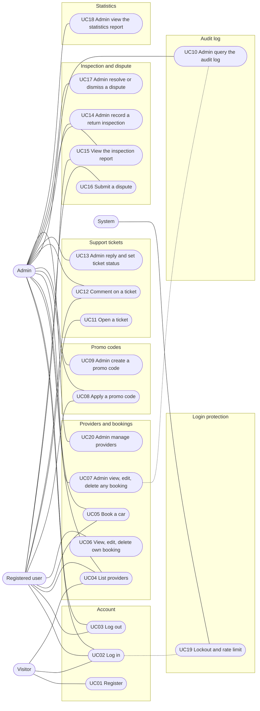

# Use Cases

Rental Car Booking REST API (Project #7), course 2110336 SW Dev Practice.

## Scope

This document describes the WHOLE API, because this repository was built as a fresh project and not as a patch on the class code. Status codes and messages are those returned by the code in `controllers/` and `middleware/`.

> **Team to fill in:** Mark here which parts differ from the class (Hospital/Appointment) code, as the slide requires; only the team knows that.

Related documents: [requirements](requirements.md), [sequence diagrams](sequence-diagrams.md), [UML profile for API](uml-profile-for-api.md), [work division](work-division.md).

## Actors

| Actor | Description |
| --- | --- |
| Visitor | Anyone without a token. Can register, log in and list providers. |
| Registered user | Has an account with role `user` and a valid token. Sees only their own bookings, tickets and inspection reports. |
| Admin | Has role `admin` (seeded from the environment at first start). Can reach any booking, ticket and inspection, and manages providers, promo codes, the audit log, disputes and statistics. |
| System | The API itself, for behaviour nobody triggers directly (brute-force protection). |

Every error is `{ success: false, message }`. Any use case that needs a token also fails with `401 Not authorized to access this route` when the token is missing, invalid or logged out. Any admin-only use case also fails with `403 User role user is not authorized to access this route` for a regular user. These two are not repeated below.

## Use-case diagram

Mermaid has no use-case diagram type, so actors are the round nodes on the left, use cases are the ellipses grouped by area, and each line joins an actor to a use case. An admin can also do everything a registered user does for a booking they may access.

The dotted lines mean "is affected by": login runs through the protection of UC19, and every admin action of UC07 (and the admin apply of UC08) leaves an entry that UC10 reads. UC11 is open to any logged-in caller but only for the caller's own booking, admins included.

## Use-case catalogue

### UC01 Register

| Item | Description |
| --- | --- |
| Actor | Visitor |
| Precondition | None |
| Main flow | 1. `POST /api/v1/auth/register` with `name`, `telephone`, `email`, `password`. 2. The API creates the user with role `user` (any `role` in the body is ignored) and hashes the password. 3. The API answers 201 with a token and `data` (`id`, `name`, `email`, `telephone`, `role`). |
| Alternative / error flows | Email already registered: 400 `Email already registered`. Missing or invalid field: 400 with the validation text, for example `Please add a valid email` or `Password must be at least 6 characters`. |
| Postcondition | A user exists and can log in. The password is never returned. |

### UC02 Log in

| Item | Description |
| --- | --- |
| Actor | Visitor (becomes a registered user or admin) |
| Precondition | The account exists |
| Main flow | 1. `POST /api/v1/auth/login` with `email` and `password`. 2. The API answers 200 with a token and `data`. 3. The client sends `Authorization: Bearer <jwt>` on later requests. |
| Alternative / error flows | Email or password missing: 400 `Please provide an email and password`. Wrong password, unknown email or locked account: 401 `Invalid credentials` (the same body for all three). More than 10 login requests a minute from one IP: 429 `Too many login attempts from this IP, please try again later` with a `Retry-After` header (see UC19). |
| Postcondition | The caller holds a token. The failed-attempt counter is reset to 0. |

### UC03 Log out

| Item | Description |
| --- | --- |
| Actor | Registered user, Admin |
| Precondition | A valid, not yet revoked token |
| Main flow | 1. `POST /api/v1/auth/logout`. 2. The API stores the hash of the token as revoked until the token's own expiry. 3. The API answers 200. |
| Alternative / error flows | Using the same token again, on any route: 401 `Not authorized to access this route` (same body as an invalid token). |
| Postcondition | The token is useless on this server, even though it has not expired. |

### UC04 List providers

| Item | Description |
| --- | --- |
| Actor | Visitor, Registered user, Admin |
| Precondition | None |
| Main flow | `GET /api/v1/providers` returns 200 with `count` and the providers (name, address, tel, late fee per hour, daily rate). `GET /api/v1/providers/:id` returns one. |
| Alternative / error flows | Unknown or malformed id: 404 `Provider not found`. |
| Postcondition | None (read only). |

### UC05 Book a car

| Item | Description |
| --- | --- |
| Actor | Registered user (admins too) |
| Precondition | Logged in; the provider exists |
| Main flow | 1. `POST /api/v1/providers/:providerId/bookings` with `date` and `returnDate`. 2. The API prices the booking as the provider's `dailyRate` x number of days (at least 1). 3. The API answers 201 with the booking (`discount` 0, `promo` null). |
| Alternative / error flows | Unknown provider: 404 `Provider not found`. Dates missing or invalid: 400 `Please provide valid date and returnDate`. Return before pickup: 400 `returnDate must not be before date`. A regular user who already holds 3 bookings: 400 `A user can book at most 3 cars` (admins are exempt). |
| Postcondition | A booking owned by the caller exists. |

### UC06 View, edit and delete own booking

| Item | Description |
| --- | --- |
| Actor | Registered user |
| Precondition | Logged in; the booking belongs to the caller |
| Main flow | `GET /api/v1/bookings` lists the caller's own bookings. `GET /api/v1/bookings/:id` shows one. `PUT /api/v1/bookings/:id` with `date`, `returnDate` and/or `provider` changes it and re-prices it (a promo already applied stays and its discount is recomputed). `DELETE /api/v1/bookings/:id` cancels it. |
| Alternative / error flows | Someone else's booking: 403 `Not authorized to access this booking`. Unknown id: 404 `Booking not found`. Bad dates: 400 `Invalid date`, `Invalid returnDate` or `returnDate must not be before date`. Unknown new provider: 404 `Provider not found`. Booking changed by a concurrent request again and again: 409 `Booking was modified concurrently, please retry`. |
| Postcondition | The booking is changed or removed. Nothing is written to the audit log for a user's own actions. |

### UC07 Admin view, edit and delete any booking

| Item | Description |
| --- | --- |
| Actor | Admin |
| Precondition | Logged in as admin |
| Main flow | 1. `GET /api/v1/bookings` returns all bookings, paginated (`page` default 1, `limit` default 20, at most 100). 2. `GET`, `PUT` or `DELETE /api/v1/bookings/:id` works on any booking. 3. Before answering, the API appends an audit entry (`view`, `edit` or `delete`); the list view appends one `view` per returned booking. |
| Alternative / error flows | Bad `page` or `limit`: 400, for example `limit must not exceed 100`. Unknown booking: 404 `Booking not found`. Concurrent change: 409 `Booking was modified concurrently, please retry`; the audit log then also holds a new `failed` entry. A PUT that changes nothing is logged as a `view`. |
| Postcondition | The audit log holds one new entry per admin action, written before the mutation. |

### UC08 Apply a promo code

| Item | Description |
| --- | --- |
| Actor | Registered user (the booking's owner), Admin |
| Precondition | Logged in; the booking is the caller's own (or the caller is admin); the booking has a price |
| Main flow | 1. `POST /api/v1/bookings/:id/promo` with `code` (case-insensitive). 2. The API claims the booking, atomically reserves one redemption on the promo, records the redemption and writes the discount into `totalPrice` (never below 0). 3. The API answers 200 with the booking. |
| Alternative / error flows | All 400: `Please provide a promo code`, `Promo code not found`, `Promo code is not yet valid`, `Promo code has expired`, `Promo code has reached its maximum redemptions`, `You have reached the per-user limit for this promo code`, `Booking already has a promo code`, `Booking has no price to discount`. Someone else's booking: 403 `Not authorized to access this booking`. Concurrent edit that cannot be reconciled: 409 `Booking was modified concurrently, please retry`. |
| Postcondition | Success: one promo on the booking, `redemptionCount` up by 1, one redemption record. Any failure: price, promo and counters are unchanged. An admin apply also leaves an `edit` audit entry. |

### UC09 Admin create a promo code

| Item | Description |
| --- | --- |
| Actor | Admin |
| Precondition | Logged in as admin |
| Main flow | 1. `POST /api/v1/promos` with `code`, `type` (`percentage` or `fixed`), `value`, `validFrom`, `validTo`, `maxRedemptions` and optional `perUserLimit`. 2. The API answers 201. `GET /api/v1/promos` lists the codes. |
| Alternative / error flows | Code already exists: 409 `Promo code already exists`. Invalid definition: 400 with the validation text, for example `A percentage value must not exceed 100`, `value must be greater than 0` or `validTo must not be before validFrom`. A regular user: 403. |
| Postcondition | The code exists with `redemptionCount` 0. |

### UC10 Admin query the audit log

| Item | Description |
| --- | --- |
| Actor | Admin |
| Precondition | Logged in as admin |
| Main flow | `GET /api/v1/audit` with optional `admin`, `booking`, `from`, `to`, `page`, `limit`. The API answers 200 with `count`, `total`, `page`, `pages` and the entries, newest first. |
| Alternative / error flows | Bad filter: 400 `admin must be a valid id`, `booking must be a valid id`, `from must be an ISO date`, `to must be an ISO date` or `from must not be after to`. Any attempt to write the log (POST, PUT, PATCH, DELETE on `/audit`): 404, there is no such route. |
| Postcondition | None (read only; the log cannot be changed through the API). |

### UC11 Open a support ticket

| Item | Description |
| --- | --- |
| Actor | Registered user (admins too, for their own bookings) |
| Precondition | Logged in; the booking belongs to the caller |
| Main flow | `POST /api/v1/tickets` with `booking`, `category` (`billing`, `vehicle issue` or `other`), `subject` (up to 200 characters) and `description` (up to 5000). The API answers 201 with status `open`. Users list their own tickets with `GET /api/v1/tickets` (admins see all and can filter by `status` and `category`) and read one thread with `GET /api/v1/tickets/:id`. |
| Alternative / error flows | `booking is required`, `category must be one of: billing, vehicle issue, other`, or a subject or description that is empty or too long: 400. Unknown booking: 404 `Booking not found`. Not the caller's booking: 403 `Not authorized to open a ticket for this booking`. Someone else's ticket: 403 `Not authorized to access this ticket`; unknown ticket: 404 `Ticket not found`. |
| Postcondition | An open ticket linked to the caller's booking exists. |

### UC12 Comment on a ticket

| Item | Description |
| --- | --- |
| Actor | Registered user (own ticket), Admin (any ticket) |
| Precondition | Logged in; the ticket is accessible to the caller |
| Main flow | `POST /api/v1/tickets/:id/comments` with `text` (1 to 2000 characters). The API appends the comment with author, role and time taken from the token and the server clock, and answers 200 with the ticket. |
| Alternative / error flows | Ticket resolved: 400 `Ticket is resolved`. 200 comments already: 400 `Ticket has reached the maximum number of comments`. Empty or too long text: 400. Someone else's ticket: 403 `Not authorized to access this ticket`. Unknown ticket: 404 `Ticket not found`. |
| Postcondition | One comment was added, or nothing changed. |

### UC13 Admin reply and change ticket status

| Item | Description |
| --- | --- |
| Actor | Admin |
| Precondition | Logged in as admin |
| Main flow | 1. The admin replies with the comment route of UC12. 2. `PUT /api/v1/tickets/:id/status` with `status` (`open`, `in progress` or `resolved`). The API answers 200 with the ticket. |
| Alternative / error flows | Invalid status: 400 `status must be one of: open, in progress, resolved`. Unknown ticket: 404 `Ticket not found`. A regular user: 403. |
| Postcondition | The ticket carries the new status; once `resolved` it accepts no more comments. |

### UC14 Admin record a return inspection (late fee)

| Item | Description |
| --- | --- |
| Actor | Admin |
| Precondition | Logged in as admin; the booking and its provider exist |
| Main flow | 1. `POST /api/v1/bookings/:id/inspection` with `actualReturnTime` (ISO with a zone), `odometer` (0 to 10000000), `fuelLevel` (0 to 100) and optional `damageNotes` (up to 5000). 2. The API takes the end of the booking's `returnDate` in UTC (23:59:59.999Z) as the scheduled return, rounds the overdue time up to whole hours and multiplies by the provider's `lateFeePerHour` (0 when on time or early). 3. The API answers 201 with the inspection, including `lateHours`, `lateFee` and `feePerHourUsed`. |
| Alternative / error flows | Unknown booking: 404 `Booking not found`. Already inspected: 409 `Inspection already recorded for this booking`. Return time not an ISO date-time with a zone: 400 `actualReturnTime must be an ISO 8601 date-time with a zone designator (Z or +hh:mm)`. Before the pickup date: 400 `actualReturnTime must not be before the pickup date`. More than 24 hours ahead: 400 `actualReturnTime must not be more than 24 hours in the future`. |
| Postcondition | One inspection with a stored fee exists for the booking. |

### UC15 View the inspection report

| Item | Description |
| --- | --- |
| Actor | Registered user (own booking), Admin |
| Precondition | Logged in; the booking is the caller's (or the caller is admin) |
| Main flow | `GET /api/v1/bookings/:id/inspection` answers 200 with the report (times, odometer, fuel, damage notes, fee, dispute). |
| Alternative / error flows | Someone else's booking: 403 `Not authorized to access this booking`. Unknown booking: 404 `Booking not found`. Not inspected yet: 404 `Inspection not found for this booking`. |
| Postcondition | None (read only). Not written to the audit log. |

### UC16 Submit a dispute

| Item | Description |
| --- | --- |
| Actor | Registered user (the booking's owner only) |
| Precondition | An inspection exists for the caller's booking and was recorded no more than 7 days ago |
| Main flow | `POST /api/v1/bookings/:id/inspection/dispute` with `comment` (1 to 2000 characters). The API answers 200 with the inspection and a dispute with status `open`. |
| Alternative / error flows | Not the owner (an admin included): 403 `Not authorized to dispute this inspection`. No inspection: 404 `Inspection not found for this booking`. Second dispute: 400 `A dispute has already been submitted` (wins when both this and the next apply). Older than 7 days: 400 `Dispute window of 7 days has passed`. Bad comment: 400 `comment must be a string` or `comment must be between 1 and 2000 characters`. |
| Postcondition | Exactly one dispute is attached to the inspection. |

### UC17 Admin resolve or dismiss a dispute

| Item | Description |
| --- | --- |
| Actor | Admin |
| Precondition | An open dispute exists |
| Main flow | `PUT /api/v1/bookings/:id/inspection/dispute` with `status` (`resolved` or `dismissed`) and optional `resolutionNote`. The API records the decision, the time and the admin, and answers 200. |
| Alternative / error flows | Other status value: 400 `status must be resolved or dismissed`. No dispute: 404 `Dispute not found for this inspection`. Already closed: 400 `Dispute has already been closed`. No inspection: 404 `Inspection not found for this booking`. |
| Postcondition | The dispute is closed. The late fee is not changed (adjusting the fee is not implemented). |

### UC18 Admin view the statistics report

| Item | Description |
| --- | --- |
| Actor | Admin |
| Precondition | Logged in as admin |
| Main flow | `GET /api/v1/stats?from=YYYY-MM-DD&to=YYYY-MM-DD` answers 200 with the range, `basis` `booking.date`, `total`, `perProvider`, `perMonth` and `top5`, all counted by one MongoDB aggregation. The range is inclusive in UTC. |
| Alternative / error flows | `from is required` or `to is required`: 400. Malformed value: 400 with the expected format. `to must not be before from`: 400. A range over 10 years: 400 `the range must not be longer than 10 years (3653 days)`. A regular user: 403. |
| Postcondition | None (read only). |

### UC19 Brute-force protection (system behaviour)

| Item | Description |
| --- | --- |
| Actor | System (triggered by every login request) |
| Precondition | None |
| Main flow | 1. The login limiter counts requests per client IP: the 11th within a minute is refused. 2. For each login the API reserves an attempt on the account with one atomic update before it compares the password. 3. The 5th consecutive failure locks the account for 15 minutes (`LOGIN_MAX_ATTEMPTS`, `LOGIN_LOCK_MINUTES`). 4. A successful login resets the counter. |
| Alternative / error flows | Over the IP limit: 429 `Too many login attempts from this IP, please try again later` with a `Retry-After` header and `retryAfter` in the body. Locked account, even with the correct password: 401 `Invalid credentials`, identical to a wrong password or an unknown email, so existing emails cannot be discovered. |
| Postcondition | After the lock time passes the account accepts the correct password again. |

### UC20 Admin manage providers

| Item | Description |
| --- | --- |
| Actor | Admin |
| Precondition | Logged in as admin |
| Main flow | `POST /api/v1/providers`, `PUT /api/v1/providers/:id` and `DELETE /api/v1/providers/:id` create, change and remove a provider (name, address, tel, `lateFeePerHour`, `dailyRate`). |
| Alternative / error flows | Invalid field: 400 with the validation text. Unknown provider: 404 `Provider not found`. Delete while the provider has bookings: 409 `Provider has bookings and cannot be deleted`. A regular user: 403. |
| Postcondition | The provider list is updated. |
